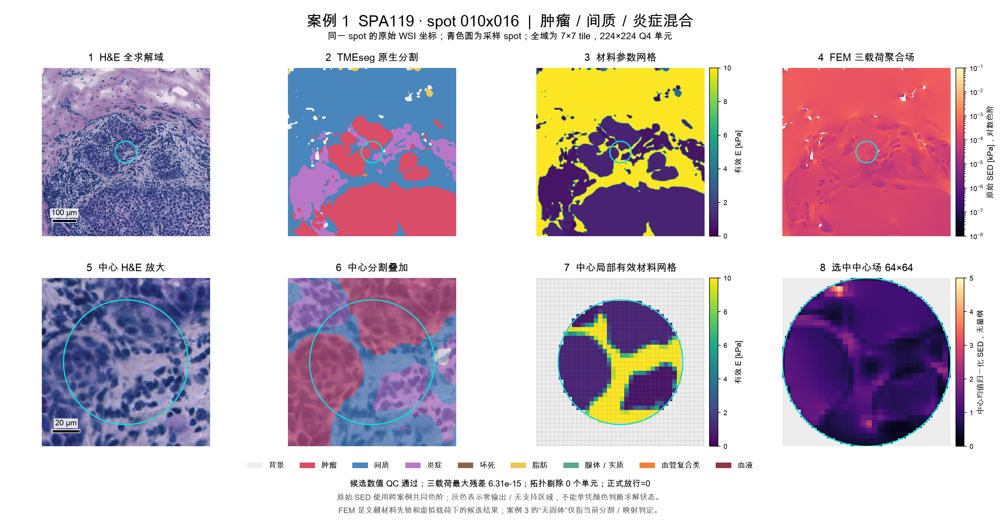

# MechSynapse 中期答辩PPT大纲

**主讲12页，计划6分40秒，预留20秒。** 根据7分钟陈述要求编排，直接纳入分割对比、有限元案例、TRIPLEX基线复现与分支消融结果。重点讲清项目任务、阶段结果、实验工作量和下一阶段验证。

本稿包含上部文字、中部证据、下部文字、讲述要点和制作提示。前三部分用于制作PPT；讲述要点用于排练；制作提示不放进幻灯片。所有【待补】须由学生用真实材料填写。不能核实的完成状态改成“进行中”或“待开展”，不能直接删除待补标记后宣称完成。

编写说明：采用8月底至9月的对比实验和10月7日归档的候选场案例，文件来源集中保存在配套说明和素材清单中。主稿选4组TRIPLEX配置、32份折级评估记录；备份另列5组配置、40份折级记录，共9组、72份记录。本次核对已有文件，未重跑实验。此段不上屏。

## 主讲页与时间

本次中期答辩的判断标准是：项目是否真实推进，阶段产物是否可核验，当前问题是否说清楚，后续任务是否有可执行的完成路径。面向不一定熟悉人工智能的老师，叙事按“目标—证据—问题—计划”展开。每页统一采用“上部文字（为什么）—中部证据—下部文字（结论）”的版式。上部文字回答“为什么讲这一页”，中部放证据，下面文字回答“证据说明什么”。章节导航用页眉或色带呈现，不增加目录页，不占用主讲时间。建议上部约15%、中部约65%、下部约20%。

| 章节 | 页码 | 标题 | 用时 | 累计 |
| --- | ---: | --- | ---: | ---: |
| 第一章 项目目标与中期进度 | 1 | 项目与团队 | 10秒 | 0:10 |
| 第一章 项目目标与中期进度 | 2 | 要解决什么问题，准备怎样解决 | 30秒 | 0:40 |
| 第一章 项目目标与中期进度 | 3 | 申报任务与中期进度 | 35秒 | 1:15 |
| 第二章 阶段实验结果 | 4 | 阶段结果一：先完成组织区域识别 | 30秒 | 1:45 |
| 第二章 阶段实验结果 | 5 | 阶段结果二：形成组织到候选力学表征的流程 | 45秒 | 2:30 |
| 第二章 阶段实验结果 | 6 | 阶段结果三：复现基线并做信息分支对照 | 40秒 | 3:10 |
| 第三章 项目衔接与待验证任务 | 7 | PathAgent复现进展与项目衔接 | 50秒 | 4:00 |
| 第三章 项目衔接与待验证任务 | 8 | 本项目关键验证：力学相关基因预测 | 45秒 | 4:45 |
| 第三章 项目衔接与待验证任务 | 9 | 当前问题与改进安排 | 25秒 | 5:10 |
| 第四章 后续计划与项目管理 | 10 | 后续计划与交付节点 | 50秒 | 6:00 |
| 第四章 后续计划与项目管理 | 11 | 团队贡献与经费使用 | 25秒 | 6:25 |
| 第四章 后续计划与项目管理 | 12 | 中期判断与下一步 | 15秒 | 6:40 |

### 第一章 项目目标与中期进度

## 第1页 项目与团队

**章节导航（页眉/色带）**：第一章 项目目标与中期进度

**上部文字（为什么）**

本页先交代项目身份、团队和本次中期检查的范围。

**中部证据**

面向肿瘤精准诊断的力学感知智能体协同决策系统  
MechSynapse 中期汇报

- 2026年本科生科研训练和实践创新基金项目
- 项目编号：XJ202610698906
- 负责人：徐佳音；成员：王培超、施维圣；指导教师：时江波
- 西安交通大学；答辩日期：【待补学院安排】

**下部文字（结论）**

项目已有阶段性实验产物，但申报书中的核心任务仍需按对应数据和指标核验。

**讲述要点**

介绍项目名称及本次汇报重点：阶段结果、实际进展与后续安排。

**制作提示**

封面保持简洁。正式名单列在基金项目中，不能沿用早期申报表的国家级申请信息。无需单独目录页。

## 第2页 要解决什么问题，准备怎样解决

**章节导航（页眉/色带）**：第一章 项目目标与中期进度

**上部文字（为什么）**

本页先说明项目要回答的问题，以及从图像到报告的基本路线。

**中部证据**

- 研究问题：常规病理形态能否预测力学相关基因表达，并为风险分层提供补充信息？
- 输入：病理全切片图像；训练和验证时使用配对RNA-seq及临床信息。
- 核心任务：形态解码、关联解释、预后评估、结果展示。
- 输出：包含模型结果、关键区域及来源记录的研究原型报告。

路线：**数据配对 → 病理特征 → 力学相关基因预测 → 关联分析 → 预后评估 → 可追溯报告**。

**下部文字（结论）**

本项目研究的是图像形态与力学相关基因表达的统计关系，不是对患者组织刚度的直接测量。

**讲述要点**

我们希望从常规病理图像中预测一组有明确来源的力学相关基因，再检验这些预测特征是否对预后分层有帮助。这里的“力学感知”是基于图像和分子信息的间接研究，不代表直接测量患者组织刚度。

**制作提示**

用一条路线配一张申报书已有病理或微环境示意图即可。背景控制在30秒。不要在本页展开全部智能体名称、模型公式或临床应用承诺。

## 第3页 申报任务与中期进度

**章节导航（页眉/色带）**：第一章 项目目标与中期进度

**上部文字（为什么）**

本页把申报书的原定任务与当前证据放在一起核对。

**中部证据**

| 申报任务 | 原定节点 | 当前成果及待完成事项 |
| --- | --- | --- |
| 队列配对与基因集合 | 2026年6月 | 已有ST数据与图像处理结果；TCGA配对病例及专项基因清单【待补】 |
| 形态解码与基因预测 | 2026年9月 | 已有TRIPLEX基线与消融；力学相关基因专项评价【待补】 |
| 关联解释 | 2026年10—11月 | 已有分割—材料—SED对应案例；形态与基因关联分析【待补】 |
| 预后与系统集成 | 2026年12月至2027年4月 | 【待补是否已启动；未启动则写后续任务】 |

页下注：当前定量结果覆盖组织分割和空间转录组预测；切片级力学相关基因预测与预后评价继续推进。

**下部文字（结论）**

现有材料支持组织分割、候选场处理和空间基因预测对照已开展；TCGA配对及专项基因预测仍不能判定完成。

**讲述要点**

按表说明已完成的具体产物和未完成任务。若核心模型尚未完成，应直接说明实际原因，并引出第10页的调整计划。

**制作提示**

每个“已完成”至少对应一个文件、结果表或可演示输出。不要填没有计算依据的“总体完成80%”。申报目标PCC > 0.3对应指定任务和基因集合，需用相同任务的结果判断达标。

### 第二章 阶段实验结果

## 第4页 阶段结果一：先完成组织区域识别

**章节导航（页眉/色带）**：第二章 阶段实验结果

**上部文字（为什么）**

本页比较三种组织分割方法，确认后续分析使用哪一种前端结果。

**中部证据**

同一人工标注H&E区域，统一映射为五类组织，比较3个已有模型。

| 模型 | Pixel Accuracy ↑ | mIoU ↑ | mDice ↑ |
| --- | ---: | ---: | ---: |
| TIAToolbox BCSS5 | 0.7977 | 0.6025 | 0.7440 |
| TMEsegBreastTCGA9 | 0.7246 | 0.4839 | 0.6256 |
| VISTA-PATH（周报配置） | 0.5387 | 0.3012 | 0.4310 |

- 工作量：3个模型的推理、标签映射、指标计算与可视化对照。
- 本示例中TIAToolbox指标最高；模型选择仍需扩大验证范围。

**配图**

**推荐图注**

2026年8月底至9月初实验。1个标注区域的初步比较，统一五类映射尚需复核；结果用于前端方案筛选。

**下部文字（结论）**

在当前共同标注区域中，TIAToolbox指标最高；单一区域结果只能用于初步筛选，不能代表完整测试集表现。

**讲述要点**

这一实验对三种组织分割模型做了同一区域对照，既有定量指标，也保留了原图、标注和预测结果，为后续材料区域构建提供依据。这里的结果只覆盖一个示例，模型选择还需扩大验证范围。

**制作提示**

表格为主，横向对比图作辅；若图中文字过小，将完整图移到备份。VISTA-PATH的提示与原生类别设置需要核对，主表保留“周报配置”，不写公平全面评测。本页评价分割标签精度，第5页评价仿真表征，两类指标各有用途。

## 第5页 阶段结果二：形成组织到候选力学表征的流程

**章节导航（页眉/色带）**：第二章 阶段实验结果

**上部文字（为什么）**

本页展示从组织图像到候选力学表征的处理链条。

**中部证据**

- 同一组织区域已形成H&E图像、组织预测标签、材料参数网格和有限元候选场。
- 示例：SPA119 / 010x016，展示组织形态与计算表征的对应关系。
- 有限元结果由材料先验和虚拟载荷计算产生，供后续方法研究使用。

工作量概览：10月归档候选数据覆盖36张切片、13,612个spot（空间采样点）。

**配图**

**推荐图注**

2026年10月7日归档。同一spot的H&E、预测分割、材料网格与候选SED。SED为应变能密度，属于给定先验下的仿真表征；尚未完成正式物理验收。

**下部文字（结论）**

当前处理覆盖36张切片、13,612个spot；候选场来自材料先验和虚拟载荷，尚未证明其代表真实组织力学状态或改善基因预测。

**讲述要点**

这组结果把病理区域、组织标签和有限元计算结果对应起来，形成了形态分析与计算表征的流程。图中的分割是模型预测，力学场是仿真结果。下一步将核验这些候选表征是否能为基因预测提供额外信息。

**制作提示**

优先讲原图上排的4个面板；下排细节可留备份。若排版时只展示部分面板，保留对应色条、图例、区域尺度及上述图注。青色圆标识同一采样spot；上排是7×7 tile域，下排为中心放大。不要把材料E图称为实测组织刚度图，不要把SED热点称为已验证肿瘤侵袭区域。

## 第6页 阶段结果三：复现基线并做信息分支对照

**章节导航（页眉/色带）**：第二章 阶段实验结果

**上部文字（为什么）**

本页用已有空间基因预测任务做基线复现和分支对照。

**中部证据**

Andersson空间基因表达预测：基线加3项分支移除对照。

| 模型 | PCC ↑ | MAE ↓ | MSE ↓ |
| --- | ---: | ---: | ---: |
| D0 原TRIPLEX | 0.4350 | 0.4373 | 0.3456 |
| D-T 去除目标分支 | 0.4356 | 0.4367 | 0.3462 |
| D-N 去除邻域分支 | 0.3648 | 0.4529 | 0.3702 |
| D-G 去除全局分支 | 0.4011 | 0.4624 | 0.3867 |

- 工作量：4组配置 × 8折 = 32份折级评估记录；其中基线8折、独立重训的分支移除对照24折。
- 去除邻域/全局分支后，PCC分别下降0.0702/0.0339，均为8折下降。
- 去除目标分支变化很小：当前协议下未检出其独立贡献。

**页下注**

Andersson数据集，8折均值，2026年9月实验。本表评价spot级基因表达预测；TCGA切片级表达预测另行验证。

**下部文字（结论）**

当前结果说明邻域与全局信息对空间spot级预测有帮助；它不能证明本项目TCGA切片级任务已达标。

**讲述要点**

这部分已有工作包括原模型基线及三个重新训练的分支移除实验。结果提示，当前协议下邻域和全局信息对预测更有帮助，目标分支的独立贡献还不明确。这为本项目设计多尺度特征对照提供了依据，也建立了可以借鉴的训练和评价流程。

**制作提示**

使用4行结果表，不将小幅差值放大为算法突破。PCC是相关系数，MAE/MSE是误差；讲清主结论即可。归档方案称“随机八折”，患者/切片隔离仍待核对，不作跨患者泛化或显著性结论。完整9组变体及SED探索放备份；原基因清单、评分聚合和配置见待补项。

### 第三章 项目衔接与待验证任务

## 第7页 PathAgent复现进展与项目衔接

**章节导航（页眉/色带）**：第三章 项目衔接与待验证任务

**上部文字（为什么）**

本页说明PathAgent复现工作处于什么阶段，以及它怎样接入本项目。

**中部证据**

本阶段复现对象：PathAgent【待补论文及仓库版本】。

| 环节 | 实际范围 | 产物或证据 |
| --- | --- | --- |
| 环境与数据准备 | 【待补模型、数据集及切片/问题数】 | 【待补配置与预处理样例】 |
| 区域检索与形态描述 | 【待补已跑通环节】 | 【待补坐标、图块与描述对应记录】 |
| 推理与评价 | 【待补单例、子集或完整评估范围】 | 【待补原始输出及指标文件】 |

与本项目衔接：**区域处理与工具记录 → 接入基因预测 → 组织可追溯报告**。

**下部文字（结论）**

PathAgent的复现完成度必须由配置、日志、原始输出和指标文件共同证明；仅有流程设计不足以判定复现完成。

**讲述要点**

用一条真实运行记录说明复现完成到哪一步，再解释它如何组织区域检索、模型调用和报告生成。前面的基因预测属于空间spot级任务；后续面向TCGA切片级RNA-seq和临床资料，需要完成样本配对、标签适配和独立评价。

**制作提示**

这页合并原稿第7—17页中的流程、设置和核心结果。已有定量结果时，用一行“在某划分的N条问题上，某指标为某值”替换冗长环境介绍。只有单例时称“单例流程验证”。完整结果表及成功、失败案例移到备份。FEM作为可选扩展，不增加必须从零完成的重型任务。

## 第8页 本项目关键验证：力学相关基因预测

**章节导航（页眉/色带）**：第三章 项目衔接与待验证任务

**上部文字（为什么）**

本页明确本项目下一步必须完成的最小基因预测实验。

**中部证据**

建议先固定一个癌种、一套标签、一个可重复运行的基线。

| 项目 | 本项目拟采用的验证设置 |
| --- | --- |
| 数据 | TCGA/GDC中可配对的WSI、RNA-seq；癌种及患者数量【待补】 |
| 标签 | 有来源版本的力学相关基因集合；明确表达单位与变换 |
| 划分 | 按患者分组；同一患者的切片和图块不跨组 |
| 对照 | 相同图像特征下，平均池化加正则化回归与注意力MIL |
| 指标 | 预定义基因集合的PCC汇总与RMSE；报告数据范围和失败情况 |

**下部文字（结论）**

现有空间转录组结果不等同于本项目TCGA切片级专项预测；申报目标是否达成目前仍无直接证据。

**讲述要点**

下一步先完成一个范围明确的图像到基因预测实验，固定患者划分和基因集合后再比较模型。确认这条主线可运行后，再考虑加入候选力学表征，或将预测特征接入生存模型。

**制作提示**

这是建议方案，不是已完成实验。若学生已取得该实验结果，用真实的“样本规模、对照指标和一张结果图”替换本页计划表。不要在测试集上挑选表现好的基因后再报告PCC。原定50—80基因、150—250例及PCC > 0.3保留为申报目标；如需调整，明确说明依据和系统要求。

## 第9页 当前问题与改进安排

**章节导航（页眉/色带）**：第三章 项目衔接与待验证任务

**上部文字（为什么）**

本页集中展示当前最影响项目可信度的三个问题。

**中部证据**

- 数据质量：已有案例提示，图像中的组织可能被分割为背景，需要核对分割和坐标处理。
- 结果验证：候选有限元场尚未完成物理验收，与基因预测的受控比较需要补齐。
- 任务衔接：优先完成TCGA配对队列、专项基因预测及工作流连接。

**配图建议**

使用“03_分割异常与周围回退_问题分析.png”的中心H&E与中心分割面板。完整图见素材目录。图注：SPA119 / 014x034；记录中中心被预测为背景，原因尚待进一步核查。

**下部文字（结论）**

该案例显示模型输出异常，但原因尚未查明；因此目前只能确认存在质量问题，不能声称问题已定位或修复。

**讲述要点**

这一案例说明，输出一张热图并不代表上游处理已经正确。我们的改进重点是保留原图、区域坐标、模型版本和异常记录，先验证输入与标签，再评价模型效果。

**制作提示**

本例用于解释数据质量问题，修复状态需另补运行证据。如果展示的是拓扑排除案例，需另用对应案例4，不能混称为同一种分割错误。本稿选用案例3，不要求讲清全部有限元细节。

### 第四章 后续计划与项目管理

## 第10页 后续计划与交付节点

**章节导航（页眉/色带）**：第四章 后续计划与项目管理

**上部文字（为什么）**

本页把剩余任务拆成有时间、有产物、有判据的交付节点。

**中部证据**

以下为调整建议，具体工作量根据实际已有数据确认。

| 时间 | 主要交付物 | 完成判据 |
| --- | --- | --- |
| 10月30日前及学院答辩前 | 中期检查表、3次月记录、复现证据包；统一队列和基因清单 | 表述与实际文件一致，能展示一条真实运行记录 |
| 2026年11—12月 | 单癌种配对队列、基因预测基线及模型对照 | 患者划分固定，预测与标签可核对，有完整PCC/RMSE报告 |
| 2027年1—2月 | 区域解释；在临床与事件数据足够时完成预后比较 | 有临床基线与加入预测特征的比较，报告C-index及不确定性 |
| 2027年3—4月 | 模型与报告流程集成 | 单病例流程可演示，输出含来源与异常状态 |
| 2027年5月 | 研究报告、代码、文档和结题材料 | 核心实验与成果文件对应；不足如实报告 |

页下注：PCC > 0.3、C-index > 0.65为申报目标，尚待本项目实测。预后与集成时点相对原计划有调整，不能表述为原计划已全部按期完成。

**下部文字（结论）**

后续任务存在明确依赖：队列和预测基线是预后比较与系统集成的前置条件；完成情况应以对应交付物核验。

**讲述要点**

后续优先保证配对数据和基因预测这条主线。预后分析以前期预测和临床数据完整为前提。沿用已有训练、评价和结果记录流程，重点推进新任务的数据适配与验证。

**制作提示**

每项填上实际负责人。数据或事件数不足时，应向导师说明影响并按学校要求处理调整，不能用问答准确率替代预后指标。只有候选SED通过受控比较后，才考虑扩大相关实验。

## 第11页 团队贡献与经费使用

**章节导航（页眉/色带）**：第四章 后续计划与项目管理

**上部文字（为什么）**

本页核对成员贡献、产物和经费记录。

**中部证据**

| 成员 | 本阶段本人完成内容 | 可核验产物 |
| --- | --- | --- |
| 徐佳音 | 【待补】 | 【待补】 |
| 王培超 | 【待补】 | 【待补】 |
| 施维圣 | 【待补】 | 【待补】 |

- 经费：正式名单所列2000元；已支出【待补】元；本次拟报销【待补】元。

**下部文字（结论）**

现有材料尚未核实成员分工与实际支出；因此本页只能在补齐对应记录后作出团队贡献和经费执行结论。

**讲述要点**

每人用一项具体工作和一项产物说明贡献。经费按真实支出和票据填写。介绍现有实验室资源如何支持后续工作。

**制作提示**

不按专业推测既成分工。没有支出记录时写“待核对”，不能默认0元；申报预算7000元不能当作已获批经费。论文、软著等只有存在实际材料时再列入成果。

## 第12页 中期判断与下一步

**章节导航（页眉/色带）**：第四章 后续计划与项目管理

**上部文字（为什么）**

本页用已有证据、当前边界和下一步交付作最后判断。

**中部证据**

- 阶段进展：已有3模型分割对比、候选有限元场和4组八折基因预测对照。
- 关键认识：邻域与全局信息有助于当前预测；候选力学表征的额外价值继续验证。
- 下一步：完成本项目力学相关基因预测验证，再推进预后分析与报告集成。

感谢各位老师，请批评指正。

**下部文字（结论）**

项目已有组织分割、候选场处理和空间基因预测对照等阶段结果；面向本项目的TCGA专项预测及预后评价仍待验证。

**讲述要点**

概括已核实的阶段结果，再明确下一阶段最优先的交付物。不要用“已实现精准诊断”“达到临床应用水平”结尾。

## 备份页建议

备份页放在致谢后，不计入7分钟主讲。

1. **PathAgent设置与结果。** 论文/仓库版本、模型、数据划分、切片数、问题数、答案提取与评分规则、实际结果。所有数值待补。
2. **PathAgent真实案例。** 成功和失败各一例，展示图块、参考答案、实际工具调用和输出；不填虚构思考过程。
3. **对比实验与工作量全表。** TRIPLEX基线、3项分支移除、5项融合/角色变体共9组配置、72份折级记录；主稿32份已包含在72份中。详见配套说明及CSV。
4. **历史SED融合探索。** 2种输入方案各8折；保留基线和2行指标、旧版零场问题、常数/打乱SED对照待补事项。不能作为已证明力学增益的结论。
5. **分割与有限元的工程验证。** 3模型单区域原图；2026年9月的36张WSI、144个共享ROI、两套分割来源各144份FEM输出及网格检查表。不同时间的数据版本分别标注。
6. **有限元案例与质量问题。** 脂肪/间质案例作第二例；保留中心与全域范围。中心分割异常用于说明质量检查的必要性。
7. **原申报任务、队列与经费明细。** 展示原计划、调整理由与实际票据。

## 材料入口

- [初稿问题与修改建议](01_初稿问题与修改建议.md)
- [补充实验结果与待补清单](03_补充实验结果与待补清单.md)
- [学生Word大纲原文转换](原文转换/学生大纲_原文.md)
