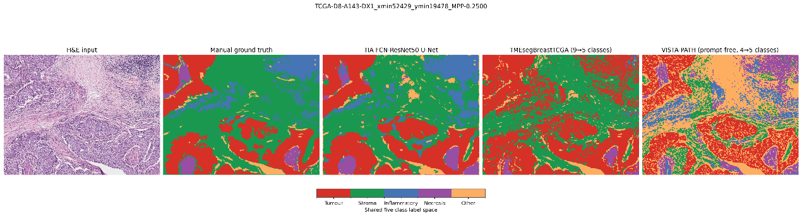

# 补充实验结果、素材索引与待补清单

整理日期：2026年10月11日。主稿直接展示实验结果，本文件保留指标口径、素材来源及答辩备查信息。依据现有周报、原图和2026年10月7日本地归档整理；本次没有重新训练或运行模型。

## 一 选入主稿的结果

| 主稿位置 | 选用内容 | 能说明的工作 | 素材 |
| --- | --- | --- | --- |
| 第4页 | 3个组织分割模型的同区域比较 | 模型运行、标签映射、指标计算和可视化检查 | 三模型指标CSV、五联原图 |
| 第5页 | H&E—分割—材料网格—候选SED对应案例 | 从组织区域到仿真表征的处理流程；候选数据覆盖36张切片、13,612个spot | 案例1；案例2留备份 |
| 第6页 | TRIPLEX基线与3项分支移除 | 4组八折对照，共32份折级评估记录；分析不同尺度信息的作用 | 四组指标CSV、分支消融报告摘录 |
| 第9页 | 中心分割为背景的异常案例 | 输入质量检查与失败原因分析 | 案例3 |

适合用于“阶段实验工作量”的一句话：

> 已形成三模型组织分割对比、候选有限元表征及TRIPLEX基线与分支消融结果；其中基因预测主表包含4组配置、32份折级评估记录。

若答辩被问及更完整的比较范围，可展示下面的9组结果及其他备份实验。32份记录已包含在72份中，不能重复相加。折级评估记录也不等于独立患者数、模型种类数或重复随机种子数。

## 二 TRIPLEX复现与对比：主稿4组，备份再加5组

任务：Andersson空间基因表达预测。运行记录来自2026年9月，汇总于10月7日归档。以下均为8折均值。

| 配置 | 实验内容 | PCC ↑ | MAE ↓ | MSE ↓ | 推荐位置 |
| --- | --- | ---: | ---: | ---: | --- |
| D0 | 原TRIPLEX基线 | 0.4350 | 0.4373 | 0.3456 | 主稿 |
| D-T | 去除Target目标分支 | 0.4356 | 0.4367 | 0.3462 | 主稿 |
| D-N | 去除Neighbor邻域分支 | 0.3648 | 0.4529 | 0.3702 | 主稿 |
| D-G | 去除Global全局分支 | 0.4011 | 0.4624 | 0.3867 | 主稿 |
| R-Q | Global职责拆分变体 | 0.4078 | 0.4546 | 0.3755 | 备份 |
| R-C | Global职责拆分变体 | 0.4426 | 0.4393 | 0.3596 | 备份 |
| R-QC | Global职责拆分变体 | 0.4421 | 0.4389 | 0.3579 | 备份 |
| G1 | 在R-C基础上调整Global内容融合 | 0.4429 | 0.4380 | 0.3564 | 备份 |
| N1 | 在R-C基础上调整Neighbor融合输入 | 0.4425 | 0.4392 | 0.3595 | 备份 |

**工作量统计：** 基线1组×8折，分支移除3组×8折，融合/职责变体5组×8折，合计9组配置、72份折级评估记录。D0为固定历史基线，D-T/D-N/D-G为独立重训的分支移除实验；备份比较重复引用的D0和D-T只计一次。

**主稿可讲的结论：** 去除Neighbor和Global后，PCC相对D0分别下降0.0702和0.0339，8折方向一致；去除Target后的变化为+0.0006，当前协议下未检出独立贡献。不要把Target分支的消融结论扩大为“目标区域没有价值”。

**备份可讲的结论：** R-C、R-QC及G1等配置的相关系数高于D0，但误差没有同步改善。例如G1的PCC为0.4429，MSE为0.3564，高于D0的0.3456。因此这组实验体现了比较和诊断工作，不能总结为全部指标全面提升。原报告的开发期阈值判断不等于统计显著性检验。

**引用范围：** 归档方案称为“随机八折”。当前整理未重新读取全部划分文件、训练配置和逐样本预测。正式报告需补齐基因清单、患者/切片隔离、训练预算及PCC汇总定义。归档中R-C诊断描述了逐切片逐基因计算PCC、按spot数加权、最终八折等权平均的口径；其他配置与其是否完全一致仍应对照原配置确认。本表不能直接认定原申报书的专项基因预测目标已经达标。

可直接使用：

- [主稿四组指标CSV](素材/TRIPLEX主稿_四组八折指标.csv)
- [完整九组指标CSV](素材/TRIPLEX基线及变体_九组八折指标.csv)
- [分支消融报告原文摘录](素材/TRIPLEX分支消融_归档报告摘录.md)
- [逐折PCC与运行标识归档摘录](素材/基线与变体逐折结果_20261007归档.txt)

## 三 三个分割模型：同一个标注区域的初步比较

| 模型 | Pixel Accuracy ↑ | mIoU ↑ | mDice ↑ |
| --- | ---: | ---: | ---: |
| TIAToolbox BCSS5 | 0.7977 | 0.6025 | 0.7440 |
| TMEsegBreastTCGA9 | 0.7246 | 0.4839 | 0.6256 |
| VISTA-PATH（周报配置） | 0.5387 | 0.3012 | 0.4310 |

来源为8.24—9.1周报，三个输出映射到肿瘤、间质、炎症/免疫、坏死、其他五类后计算指标。原图标识区域为 `TCGA-D8-A143-DX1_xmin52429_ymin19478_MPP-0.2500`。

工作量写“3个模型、1个共同标注区域的推理和指标对照”。此处不是三个完整测试集的复现。五类映射、提示设置和训练来源重叠情况仍待核实；尤其周报把VISTA配置记为“无框、四类提示”，图内又写“prompt-free, 4→5”，需回查原始推理配置。当前宜用“本示例区域中TIAToolbox指标最高”。

可直接使用：[三模型指标CSV](素材/三模型分割对比_单区域指标.csv)。原图从Word内嵌图片提取，未重绘预测结果。

## 四 有限元表征：案例与工程规模

### 主稿用一个完整案例

推荐[案例1：SPA119 / 010x016](素材/01_组织分割与有限元候选场_主稿.png)。按H&E、预测组织标签、材料参数网格、SED讲述。SED是应变能密度，是材料先验与虚拟载荷下的候选仿真结果。材料E图不能称为患者组织刚度实测图。

10月6—7日记录覆盖36张切片、13,612个spot，其中13,593个使用中心场，19个使用周围场回退。该记录中的正式验收标志均为0；数据覆盖量可作为处理规模，不能表述为13,612份已获物理验证的结果。10月状态与9月历史训练数据属于不同版本。

案例素材：

- [案例1：肿瘤、间质及炎症混合](素材/01_组织分割与有限元候选场_主稿.png)：主稿第5页。
- [案例2：脂肪与间质混合](素材/02_脂肪间质案例_备份.png)：备份中的第二例。
- [案例3：中心分割异常与周围回退](素材/03_分割异常与周围回退_问题分析.png)：主稿第9页或备份。

案例3的原图有组织，而中心标签全为背景；原因尚不能确定为模型误分、坐标投影或其他预处理环节。案例4属于分割识别到组织后又被拓扑处理排除，机制不同，本次未选入。显示候选场不等于异常已修复。

### 备份可增加两套分割来源的FEM网格检查

8.31—9.5周报记录：36张WSI中选取144个共享ROI，最多4个/张，每个为1.5 mm × 1.5 mm；两种分割来源在相同区域分别生成有限元结果。

| 检查项 | TMEseg来源 | TIA来源 |
| --- | ---: | ---: |
| 完成的共享ROI | 144/144 | 144/144 |
| 严格网格检查通过 | 63/144（43.8%） | 27/144（18.8%） |
| 中位网格差异 | 0.0578 | 0.0649 |
| 中位Spearman | 0.9404 | 0.9134 |

工作量写“144个共享区域、两套分割输入，各完成144份ROI有限元输出”。不要写288例患者。该表衡量网格变化下的数值稳定性，不能作为分割真值精度或真实组织力学准确性的证据。因此，分割示例上TIA指标较高，而此处TME网格稳定性较高，两者并不矛盾。

可直接使用：[历史ROI网格检查CSV](素材/两套分割来源_FEM网格检查_历史结果.csv)。这批9月ROI结果与10月spot候选场版本分别展示，不拼成同一批次的总体通过率。

## 五 历史SED融合结果：保留在备份

2026年9月20日的探索实验，两种SED输入方案各8折。SED两行均值已从9月22日保存的逐折指标重新计算。

| 配置 | PCC ↑ | MAE ↓ | MSE ↓ |
| --- | ---: | ---: | ---: |
| 原TRIPLEX参照 | 0.4350 | 0.4373 | 0.3456 |
| SED1矩形ROI | 0.4374 | 0.4350 | 0.3427 |
| SED1严格圆形spot | 0.4376 | 0.4348 | 0.3424 |

工作量为“2种输入方案×8折，共16份探索性评估记录”。这16份与前述视觉分支/融合9组分开列示，因为输入版本和研究目的不同；参照基线也不再累计一次。

这组结果适合说明已做过候选力学表征融合，但不能用来宣称已证明力学信息有效。旧版存在4,554/13,612（约33.46%）未求解零场被计为有效输入的问题，且缺少匹配的常数SED、折内打乱SED对照。模型中的额外视觉路径也可能影响结果。需要在固定数据版本和预算下重新比较，才能判断增益来源。

可直接使用：[SED历史指标CSV](素材/历史基因预测指标_可编辑表.csv)、[逐折指标与数据核查快照](素材/八折结果与数据核查快照_20260922.json)。这不是10月候选数据修复后的训练结果。

## 六 暂不选入的结果

| 材料 | 本次处理及原因 |
| --- | --- |
| 7月14日PPT第3页四层/五层视觉对比 | 暂不引用。Full显示的5折PCC均值为0.33922，结论栏却使用0.3498；因此“+0.0067”的比较口径无法由该页逐折数值支持。需查原表后再用 |
| 4月答辩中STNet、EGN、TRIPLEX、BLEEP、OmiCLIP、Stem“已完成复现”列表 | 除本次已定位的TRIPLEX外，暂不扩展为已核实的定量对比表。现有页面缺少对应数据划分、配置、预测与指标文件 |
| 只有目录、脚本名或计划的实验 | 不计为已完成评估。可在后续计划中列出 |

## 七 答辩前需要补齐的内容

| 优先级 | 待补项 | 最小交付物 | 对应页面 |
| --- | --- | --- | --- |
| 必须 | 正式项目与提交要求 | 确认系统申报版本、学院答辩日期、10月30日前材料及3次月进展记录 | 1、3、10 |
| 必须 | PathAgent实际复现范围 | 论文/仓库版本；数据与模型配置；一条可追溯运行记录；已有指标或明确单例/子集范围 | 7及备份 |
| 必须 | 原计划进度差距 | TCGA患者配对清单、基因集合、已有训练状态；未完成任务的原因与具体恢复节点 | 3、8、10 |
| 必须 | 团队与经费 | 实际分工、对应产物、已支出及报销票据 | 11 |
| 应补 | TRIPLEX评价口径 | 划分清单、基因清单、参数配置、指标聚合脚本，核对与归档表的一致性 | 6及备份 |
| 应补 | 分割比较设置 | 标注来源、五类映射、VISTA提示配置、是否与训练区域重叠 | 4及备份 |
| 后续实验 | 专项基因预测 | 固定患者划分后完成一个癌种的基线与模型比较；报告完整预定义基因集合 | 8、10 |
| 后续实验 | 候选SED是否有用 | 相同数据版本和预算下比较无SED、真实SED、常数SED、折内打乱SED | 9、10 |

## 八 三个常见追问的回答要点

**“PCC已经超过0.3，项目是否完成了阶段目标？”** 当前0.4350等数值来自Andersson空间转录组任务。申报目标对应拟定队列和力学相关基因集合，需要完成相同任务的评价后判断。现阶段已有可参考的预测基线和对照流程。

**“做了这么多对比，主要收获是什么？”** 分割比较支持前端模型筛选；分支消融提示当前预测更依赖邻域与全局信息；后续融合比较显示相关性与误差可能不同步，指导下一步同时关注两类指标。

**“力学表征带来提升了吗？”** 历史探索中观察到小幅指标变化，但旧输入存在质量问题，受控比较还不完整。当前可确认的是已形成候选表征与融合实验流程；其独立价值继续验证。

## 九 文件来源

以下材料来自教师侧刘煜指导目录；本交付包只提供已整理的“素材”文件夹和结果说明。

| 编号 | 原始材料 | 用途 |
| --- | --- | --- |
| L1 | 8.24—9.1周报（教师侧原始文件，未随包提供） | 三模型分割表及图1 |
| L2 | 8.31—9.5周报（教师侧原始文件，未随包提供） | 144个共享ROI与网格检查 |
| L3 | 9月第三周周报（教师侧原始文件，未随包提供） | SED探索结果背景 |
| L4 | 9月22日核查摘要（教师侧原始文件，未随包提供） | SED逐折指标及旧输入质量 |
| L5 | 10月7日评估汇总归档（教师侧原始文件，未随包提供） | 基线、分支移除与变体的逐折PCC及均值 |
| L6 | 10月7日报告归档（教师侧原始文件，未随包提供） | 分支移除、职责拆分及诊断报告 |
| L7 | 10月状态文档（教师侧原始文件，未随包提供）、原始案例说明（教师侧原始文件，未随包提供） | 36张切片、13,612个spot、案例及候选状态 |
| L8 | 7月14日PPT（教师侧原始文件，未随包提供） | 逐折与结论栏不一致，暂不采用 |

[素材来源清单](素材/素材来源清单.json)记录复制路径、来源位置和SHA-256。复制的[原案例说明](素材/来源说明_20261007.md)保持原文，其中提到的四例总览、案例4和原始数组未全部纳入本次素材包；本次交付的三张案例图按本页链接使用。
